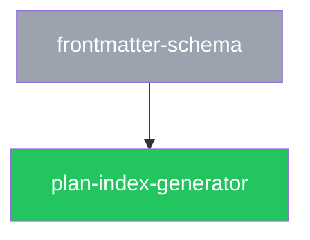

# File formats: frontmatter schemas, naming, markdown conventions, and templates

This spec defines the exact format of every Specplane file type, including JSON Schema definitions for all frontmatter, section conventions, and copy-paste templates.

---

## 1. Spec files

### 1.1 Frontmatter JSON Schema

#### Common fields (all specs)

```json
{
  "$schema": "http://json-schema.org/draft-07/schema#",
  "type": "object",
  "required": ["id", "title", "status", "author"],
  "additionalProperties": true,
  "properties": {
    "id": {
      "type": "string",
      "pattern": "^(feature|architecture)/[a-z0-9][a-z0-9/-]*[a-z0-9]$",
      "description": "Path-derived spec ID. Immutable after creation."
    },
    "title": { "type": "string", "minLength": 1 },
    "status": {
      "type": "string",
      "enum": ["draft", "review", "approved", "deprecated"]
    },
    "author": {
      "type": "string",
      "enum": ["user", "llm", "mixed"]
    },
    "supersedes": {
      "type": "array",
      "items": { "type": "string" },
      "default": []
    },
    "extends": {
      "type": "string",
      "description": "For overlay specs only. Format: '<root>:<type>/<slug>' or '<type>/<slug>'."
    }
  }
}
```

#### Additional fields for feature specs

```json
{
  "properties": {
    "allow_architecture": { "type": "boolean", "default": false },
    "architecture_reason": {
      "type": "string",
      "description": "Required non-empty when allow_architecture is true."
    }
  }
}
```

Validation rule: if `allow_architecture` is `true`, `architecture_reason` must be a non-empty string.

#### Additional fields for architecture specs

```json
{
  "required": ["implements"],
  "properties": {
    "implements": {
      "type": "array",
      "items": { "type": "string" },
      "minItems": 1,
      "description": "Feature spec IDs this architecture spec implements."
    }
  }
}
```

### 1.2 Section conventions

Spec files are free-form markdown after the frontmatter, but are expected to follow these conventions:

- **Feature specs**: top-level heading = title. Sections for: description/overview, rules and invariants, acceptance scenarios (Using Given/When/Then or equivalent), edge cases. The glossary lives in `feature/spec-system`; specs reference it rather than redefining terms.
- **Architecture specs**: top-level heading = title. Sections for: overview, component breakdown, data structures/schemas, algorithms, error handling, integration points.

Section headings use H2 (`##`). Subsections use H3 (`###`). Deepen only when necessary.

### 1.3 Feature spec template

```markdown
---
id: feature/<slug>
title: <Title>
status: draft
author: user
---

# <Title>

<One-paragraph description of what this spec covers.>

---

## Rules

- <Rule 1>
- <Rule 2>

---

## Acceptance scenarios

### Scenario 1: <Name>

Given <precondition>,
When <action>,
Then <outcome>.

---

## Edge cases

- <Edge case 1>
```

### 1.4 Architecture spec template

```markdown
---
id: architecture/<slug>
title: <Title>
status: draft
author: llm
implements: [feature/<slug>]
---

# <Title>

<One-paragraph overview.>

---

## Components

### <Component name>

<Responsibility and interface.>

---

## Data structures

<Schemas, types, field definitions.>

---

## Error handling

<How errors are detected, represented, and propagated.>
```

---

## 2. Plan files

### 2.1 PLAN.md frontmatter JSON Schema

```json
{
  "$schema": "http://json-schema.org/draft-07/schema#",
  "type": "object",
  "required": ["id", "title", "status", "specs"],
  "additionalProperties": false,
  "properties": {
    "id": {
      "type": "string",
      "pattern": "^\\d{4}-\\d{2}-\\d{2}-[a-z0-9][a-z0-9-]*[a-z0-9]$",
      "description": "YYYY-MM-DD-<slug>. Immutable. Must match the folder name."
    },
    "title": { "type": "string", "minLength": 1 },
    "status": {
      "type": "string",
      "enum": ["draft", "ready", "in_progress", "review", "done", "abandoned"],
      "description": "in_progress and review are valid only when plans.status_source is frontmatter; with status_source git they produce a warning (see feature/plan-status)."
    },
    "specs": {
      "type": "array",
      "items": { "type": "string" },
      "minItems": 1
    },
    "depends_on": {
      "type": "array",
      "items": { "type": "string" },
      "default": []
    }
  }
}
```

### 2.2 PLAN.md body sections

PLAN.md body is markdown with the following recommended sections (order conventional, not enforced):

1. `## Goal` — one paragraph
2. `## Scope` — bullet list of what's in scope
3. `## Non-goals` — bullet list of explicit exclusions
4. `## Specs implemented` — table or list of spec IDs with notes
5. `## Acceptance criteria` — checklist
6. `## Risks` — numbered list
7. `## Steps` — ordered list with one-line summary per step

### 2.3 PLAN.md template

```markdown
---
id: YYYY-MM-DD-<slug>
title: <Title>
status: draft
specs: [feature/<slug>]
depends_on: []
---

# <Title>

## Goal

<What this plan achieves.>

## Scope

- <In-scope item 1>

## Non-goals

- <Out-of-scope item 1>

## Specs implemented

| Spec | Coverage |
|------|----------|
| `feature/<slug>` | <Which aspects> |

## Acceptance criteria

- [ ] <Criterion 1>
- [ ] <Criterion 2>

## Risks

1. <Risk 1>

## Steps

1. `01-<slug>`: <One-line summary>
2. `02-<slug>`: <One-line summary>
```

---

## 3. Step files

### 3.1 Step frontmatter JSON Schema

```json
{
  "$schema": "http://json-schema.org/draft-07/schema#",
  "type": "object",
  "required": ["plan", "step", "title", "status"],
  "additionalProperties": false,
  "properties": {
    "plan": {
      "type": "string",
      "description": "Parent plan ID. Must match the containing plan folder name."
    },
    "step": {
      "type": "integer",
      "minimum": 1,
      "description": "Step number. Must match the numeric prefix of the filename."
    },
    "title": { "type": "string", "minLength": 1 },
    "status": {
      "type": "string",
      "enum": ["pending", "done", "skipped", "blocked"]
    },
    "context": {
      "type": "array",
      "items": {
        "type": "object",
        "oneOf": [
          { "required": ["spec"],      "properties": { "spec":     { "type": "string" } }, "additionalProperties": false },
          { "required": ["decision"],  "properties": { "decision": { "type": "string" } }, "additionalProperties": false },
          { "required": ["file"],      "properties": { "file":     { "type": "string" } }, "additionalProperties": false }
        ]
      },
      "default": []
    },
    "use_subagent": {
      "type": "boolean",
      "default": false,
      "description": "Harness opt-in: run this step in a subagent. See feature/agent-integration."
    }
  }
}
```

### 3.2 Validation rules for step files

- `step` value must equal the numeric prefix parsed from the filename (e.g. `step: 2` in `02-graph-builder.md`).
- `plan` value must equal the plan ID of the containing folder (i.e. the folder name under `plans/`).
- Step numbers across all files in `steps/` must be contiguous starting at 1. Missing numbers and duplicates are errors.
- All `context[].spec` values must resolve to a known spec ID (warning if spec is `draft`). A value may carry a `#<heading>` anchor (e.g. `architecture/reference-cli#Config loading`). The anchor matches the first H2/H3 heading whose text — compared case-insensitively, with inline code markup and any leading section number (such as `5.` or `3.2`) removed — equals the anchor or begins with the anchor followed by a space. An anchor that matches no heading is a warning.
- All `context[].decision` values must be ADR IDs (`decision/NNNN`) that resolve to an ADR in the configured decisions directory (`decisions.dir`).
- All `context[].file` values: paths that do not exist at validation time produce a warning (the file may not exist yet).
- A step with `status: skipped` or `status: blocked` must have a HANDOFF.md section for that step.

### 3.3 Step file body sections

Step body is markdown with these sections (required):

1. `## Goal` — one paragraph
2. `## Acceptance criteria` — checklist
3. `## Tasks` — ordered list of imperative actions
4. `## Guidance` (optional) — notes, pitfalls, constraints

The context to load is declared only in the `context` frontmatter field; the body does not repeat it.

### 3.4 Step file template

```markdown
---
plan: YYYY-MM-DD-<plan-slug>
step: 1
title: <Title>
status: pending
context:
  - spec: architecture/<slug>
  - decision: decision/NNNN
  - file: src/<path>/
---

## Goal

<What this step must accomplish.>

## Acceptance criteria

- [ ] <Criterion 1>
- [ ] <Criterion 2>

## Tasks

1. <Imperative action 1>
2. <Imperative action 2>

## Guidance

<Optional notes.>
```

---

## 4. HANDOFF.md

HANDOFF.md is an append-only log. Each step's agent appends one section.

### 4.1 Format

```markdown
# HANDOFF — <plan-id>

## Step NN: <step title>

**Date**: YYYY-MM-DD
**Outcome**: done | skipped | blocked

### What changed

- `<path>`: <reason>

### Deviations from the plan

None. | <Description of deviations.>

### Gaps found in specs

None. | - Gap: `<spec-id>` does not specify <X>. Used <source> instead.

### Open issues

None. | - <Description of open issue.>

### What the next step must know

<Key facts. Must be self-contained.>
```

The "None." token is used when a section has nothing to report. All sections are required.

`**Outcome**` must equal the step's frontmatter `status` in the same commit. For `skipped`, "What changed" is "None." and "Deviations from the plan" states why the step was skipped. For `blocked`, "Open issues" contains at least one `BLOCKED:` item. When a blocked step is later resumed, a new section with the same heading is appended; earlier sections are never edited.

---

## 5. PLANS.md

### 5.1 Format

````markdown
<!-- GENERATED FILE — do not edit by hand. Regenerate with: specplane generate -->

# Plans

## Active plans

| ID | Title | Status | Dependencies | Specs |
|----|-------|--------|--------------|-------|
| [2026-10-28-plan-index-generator](2026-10-28-plan-index-generator/PLAN.md) | Generate PLANS.md | ready | [2026-10-20-frontmatter-schema](archive/2026-10-20-frontmatter-schema/PLAN.md) | feature/plan-index |

## Archived plans

| ID | Title | Status | Specs |
|----|-------|--------|-------|
| [2026-10-20-frontmatter-schema](archive/2026-10-20-frontmatter-schema/PLAN.md) | Frontmatter schema | done | feature/spec-system |

## Dependency graph


````

(The outer fence above uses four backticks only so that the nested `mermaid` block displays; the generated file itself contains the inner three-backtick block directly.)

### 5.2 Generation rules

The output is deterministic: generating twice from the same commit produces byte-identical files. Therefore:

- No timestamp or other run-dependent value is written.
- The Status column is the **index status**: the stored status, except that a `ready` plan with an unmet dependency is shown as `blocked` (see `feature/plan-index`). Git- and forge-derived statuses are not written to the file.
- Active rows and archived rows are each sorted by plan ID.
- Dependencies are rendered as links to the dependency's `PLAN.md` (archived or active path); `—` when there are none. Archived rows omit the Dependencies column.
- An empty table section is rendered as `_None._` instead of a table.
- Mermaid node key: `p_` followed by the plan ID with `-` replaced by `_` (always a valid, unique Mermaid identifier). Node label: the plan slug (ID without the date prefix).
- Nodes are emitted in plan-ID order, then edges (`dependency --> dependent`) in order of dependent then dependency ID. Plans with no edges are emitted as standalone nodes.
- All seven `classDef` lines are always emitted, in the order shown above.

---

## 6. ADR files

### 6.1 ADR frontmatter JSON Schema

```json
{
  "$schema": "http://json-schema.org/draft-07/schema#",
  "type": "object",
  "required": ["id", "title", "date", "status"],
  "additionalProperties": false,
  "properties": {
    "id": {
      "type": "string",
      "pattern": "^decision/\\d{4}$",
      "description": "decision/NNNN — zero-padded four-digit number."
    },
    "title": { "type": "string", "minLength": 1 },
    "date": {
      "type": "string",
      "format": "date",
      "description": "ISO 8601 date: YYYY-MM-DD."
    },
    "status": {
      "type": "string",
      "enum": ["proposed", "accepted", "superseded", "deprecated"]
    },
    "superseded_by": { "type": "string", "default": "" },
    "related_specs": {
      "type": "array",
      "items": { "type": "string" },
      "default": []
    }
  }
}
```

### 6.2 ADR validation rules

- `id` must equal `decision/` plus the four-digit filename prefix (e.g. `decision/0002` for `0002-reference-cli-language.md`).
- Two ADR files with the same number are an error: "Duplicate ADR number `0003`: `0003-a.md`, `0003-b.md`. Renumber the later one." Numbers are chosen sequentially, so ADRs created on parallel branches can collide without a git conflict; this check (run on pull requests by CI) is what surfaces the collision before merge.
- `status: superseded` requires a non-empty `superseded_by` that resolves to an existing ADR; a non-empty `superseded_by` requires `status: superseded`.
- `related_specs` entries that do not resolve produce a warning.

### 6.3 ADR template

```markdown
---
id: decision/NNNN
title: <Decision title>
date: YYYY-MM-DD
status: proposed
superseded_by: ""
related_specs: []
---

# <Decision title>

## Context

<Problem and forces.>

## Options considered

### Option A: <Name>

<Pros/cons.>

### Option B: <Name>

<Pros/cons.>

## Decision

<The choice, in one sentence.>

## Consequences

<Benefits, trade-offs, follow-up work.>
```

---

## 7. Config file

### 7.1 Config JSON Schema

```json
{
  "$schema": "http://json-schema.org/draft-07/schema#",
  "type": "object",
  "additionalProperties": false,
  "properties": {
    "spec_roots": {
      "type": "array",
      "minItems": 1,
      "items": {
        "type": "object",
        "required": ["name", "path"],
        "additionalProperties": false,
        "properties": {
          "name":    { "type": "string" },
          "path":    { "type": "string" },
          "extends": { "type": "string" }
        }
      }
    },
    "specs": {
      "type": "object",
      "additionalProperties": false,
      "properties": {
        "llm_review": { "type": "boolean" },
        "feature": {
          "type": "object",
          "additionalProperties": false,
          "properties": {
            "authorship":          { "type": "string", "enum": ["user","llm","either"] },
            "llm_role":            { "type": "string", "enum": ["assist","draft","none"] },
            "forbid_architecture": { "type": "boolean" },
            "leak_guard_allow":    { "type": "array", "items": { "type": "string" } }
          }
        },
        "architecture": {
          "type": "object",
          "additionalProperties": false,
          "properties": {
            "authorship":                 { "type": "string", "enum": ["user","llm","either"] },
            "llm_role":                   { "type": "string", "enum": ["assist","draft","none"] },
            "require_approved_features":  { "type": "boolean" }
          }
        }
      }
    },
    "plans": {
      "type": "object",
      "additionalProperties": false,
      "properties": {
        "dir":                   { "type": "string" },
        "require_approved_specs": { "type": "string", "enum": ["none","feature","feature_and_architecture"] },
        "status_source":         { "type": "string", "enum": ["git","frontmatter"] },
        "merge":                 { "type": "string", "enum": ["pull_request","local_merge"] },
        "dependency_mode":       { "type": "string", "enum": ["wait_for_merge","stack"] },
        "archive_done":          { "type": "boolean" },
        "setup_hook":            { "type": "string" },
        "test_command":          { "type": "string" },
        "forge":                 { "type": "string", "enum": ["auto","github","none"] }
      }
    },
    "execution": {
      "type": "object",
      "additionalProperties": false,
      "properties": {
        "backend":       { "type": "string", "enum": ["worktree","branch","external"] },
        "worktree_dir":  { "type": "string" }
      }
    },
    "decisions": {
      "type": "object",
      "additionalProperties": false,
      "properties": {
        "dir": { "type": "string" }
      }
    }
  }
}
```

### 7.2 Severity mapping

The schema is strict so that typos are caught, but `feature/configuration` requires unknown keys to be tolerated for forward compatibility. Validators therefore map schema violations to severities as follows:

- An `additionalProperties` violation (unknown key) is a **warning**: "Unknown config key `<path>`; ignoring." The key is dropped before defaults are merged.
- Every other violation (wrong type, invalid enum value, missing `name`/`path` in a root) is an **error**.

Cross-field rules not expressible in the schema (errors): duplicate root names; a root `extends` an undeclared root; a cycle in root `extends` chains; `execution.worktree_dir` resolving inside the repository.
