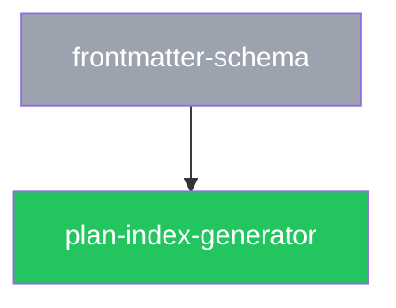

<!-- Plan index proposal 2026-11-02: user agreed naming/source semantics and approved the companion feature patch, now applied. Architecture revision awaits review; not implemented behavior. -->


<!-- Architecture reconciliation 2026-11-02: current feature contracts govern this draft revision. Stored lifecycle status and dependency pins are preserved; this edit is not approval or evidence of implementation. -->

<!-- Revision 2026-11-01: extension/core separation and contribution provenance agreed in conversation; existing lifecycle status is unchanged. Implementation and integration review remain pending. -->

<!-- Experimental development amendment 2026-11-01; these branch changes await human final review. -->

# File formats: frontmatter schemas, naming, markdown conventions, and templates

This spec defines the exact format of every Specplane file type, including JSON Schema definitions for all frontmatter, section conventions, and copy-paste templates.

---

## 1. Spec files

### 1.1 Frontmatter JSON Schema

#### Common fields (all specs)

```json
{
  "$schema": "http://json-schema.org/draft-07/schema#",
  "type": "object",
  "required": [
    "id",
    "title",
    "status",
    "author"
  ],
  "additionalProperties": true,
  "properties": {
    "id": {
      "type": "string",
      "pattern": "^(feature|architecture)/[a-z0-9](?:[a-z0-9-]|/(?!/))*[a-z0-9]$",
      "description": "Path-derived spec ID: the type prefix, then at least two characters from a-z, 0-9, hyphen, and single slashes; it starts and ends with a letter or digit and never contains //. Immutable after creation."
    },
    "title": {
      "type": "string",
      "minLength": 1
    },
    "status": {
      "type": "string",
      "enum": [
        "draft",
        "review",
        "approved",
        "deprecated"
      ]
    },
    "author": {
      "type": "string",
      "enum": [
        "user",
        "llm",
        "mixed"
      ]
    },
    "contributors": {
      "type": "array",
      "items": {
        "type": "object",
        "required": [
          "id",
          "kind",
          "roles"
        ],
        "additionalProperties": false,
        "properties": {
          "id": {
            "type": "string",
            "minLength": 1
          },
          "kind": {
            "enum": [
              "human",
              "model"
            ]
          },
          "display_name": {
            "type": "string"
          },
          "provider": {
            "type": "string",
            "minLength": 1
          },
          "model_id": {
            "type": "string",
            "minLength": 1
          },
          "roles": {
            "type": "array",
            "minItems": 1,
            "uniqueItems": true,
            "items": {
              "enum": [
                "create",
                "revise",
                "review"
              ]
            }
          }
        }
      }
    },
    "supersedes": {
      "type": "array",
      "items": {
        "type": "string"
      },
      "default": []
    },
    "extends": {
      "oneOf": [
        {
          "type": "string"
        },
        {
          "type": "array",
          "items": {
            "type": "string"
          },
          "minItems": 1
        }
      ],
      "description": "For overlay specs only. One ID or a list of IDs. Format: '<root>:<type>/<slug>' or '<type>/<slug>'."
    },
    "based_on": {
      "type": "object",
      "additionalProperties": {
        "type": "string",
        "pattern": "^[0-9a-f]{7,40}$"
      },
      "description": "Optional, any spec type. Maps a referenced spec ID to the abbreviated git blob hash of that spec's file when this spec was last reviewed against it. Keys must appear in 'extends' or 'implements'."
    },
    "implementation": {
      "type": "object",
      "required": [
        "status"
      ],
      "additionalProperties": false,
      "properties": {
        "status": {
          "enum": [
            "incomplete",
            "partial",
            "complete"
          ]
        },
        "assessed_spec_hash": {
          "type": "string",
          "pattern": "^[a-z0-9][a-z0-9-]*:sha256:[0-9a-f]{64}$"
        },
        "assessed_dependencies": {
          "type": "object",
          "additionalProperties": {
            "type": "string",
            "pattern": "^[a-z0-9][a-z0-9-]*:sha256:[0-9a-f]{64}$"
          }
        },
        "evidence": {
          "type": "array",
          "items": {
            "type": "string",
            "minLength": 1
          }
        },
        "implementation_revision": {
          "type": "string",
          "minLength": 1
        }
      }
    }
  }
}
```

ID pattern: after `feature/` or `architecture/` the ID has at least two characters, made of lowercase letters, digits, hyphens, and single `/` separators; it starts and ends with a letter or digit, and `//` is never allowed. Valid: `feature/search`, `architecture/plan-system`, `feature/a1`, `feature/group/sub-topic`. Invalid: `feature/a` (one character), `feature/a//b` (empty segment), `feature/-a` and `feature/a-` (hyphen at an end), `feature/Search` (uppercase).

`based_on` values are written by `specplane spec pin` (`git rev-parse HEAD:<path>`, abbreviated to at least 7 hex characters). A pin is content-addressed, so it survives rebase and squash, and `git diff <pin> <current>` shows what changed in the base. Anchors: any spec ID in `extends`, `implements`, `supersedes`, or `based_on` may carry a section anchor `<id>#<heading-slug>`; the slug is the GitHub-style slug of a heading in the referenced spec (lowercase, punctuation removed, spaces to hyphens, `-1`, `-2` suffixes for duplicates). A `based_on` key is the ID without the anchor.

#### Additional fields for feature specs

```json
{
  "properties": {
    "allow_architecture": { "type": "boolean", "default": false },
    "architecture_reason": {
      "type": "string",
      "description": "Required non-empty when allow_architecture is true."
    }
  }
}
```

Validation rule: if `allow_architecture` is `true`, `architecture_reason` must be a non-empty string.

#### Additional fields for architecture specs

```json
{
  "required": ["implements"],
  "properties": {
    "implements": {
      "type": "array",
      "items": { "type": "string" },
      "minItems": 1,
      "description": "Feature spec IDs this architecture spec implements."
    }
  }
}
```

### 1.2 Section conventions

Spec files are free-form markdown after the frontmatter, but are expected to follow these conventions:

- **Feature specs**: top-level heading = title. Sections for: description/overview, rules and invariants, acceptance scenarios (Using Given/When/Then or equivalent), edge cases. The glossary lives in `feature/spec-system`; specs reference it rather than redefining terms.
- **Architecture specs**: top-level heading = title. Sections for: overview, component breakdown, data structures/schemas, algorithms, error handling, integration points.

Section headings use H2 (`##`). Subsections use H3 (`###`). Deepen only when necessary.

### 1.3 Feature spec template

```markdown
---
id: feature/<slug>
title: <Title>
status: draft
author: user
---

# <Title>

<One-paragraph description of what this spec covers.>

---

## Rules

- <Rule 1>
- <Rule 2>

---

## Acceptance scenarios

### Scenario 1: <Name>

Given <precondition>,
When <action>,
Then <outcome>.

---

## Edge cases

- <Edge case 1>
```

### 1.4 Architecture spec template

```markdown
---
id: architecture/<slug>
title: <Title>
status: draft
author: llm
implements: [feature/<slug>]
---

# <Title>

<One-paragraph overview.>

---

## Components

### <Component name>

<Responsibility and interface.>

---

## Data structures

<Schemas, types, field definitions.>

---

## Error handling

<How errors are detected, represented, and propagated.>
```

### 1.5 Pin, anchor, and skill-contract findings

Messages for the findings defined in `feature/spec-overlays#base-pins` and `architecture/agent-skills` § Keeping skills in sync with specs. `<ref>` is the referenced spec ID as written; `<pin>` and `<new>` are abbreviated blob hashes.

| Type | Severity | Condition | Message |
|------|----------|-----------|---------|
| `base-changed` | warning | Pin differs from the current blob (after normalisation) | "`<id>` was reviewed against an older `<ref>`; review `git diff <pin> <new>` then run `specplane spec pin <id>`." |
| `base-changed` | warning | As above, pinned blob missing locally | The same message, followed by " (diff unavailable: `<pin>` is not in the local object store)." |
| `base-changed` | error | Stale pin on an `approved` spec | "Cannot approve `<id>`: base `<ref>` changed since it was pinned." |
| `pin` | warning (`warn`) / error (`require`) | Missing pin per `specs.pin_bases` | "`<id>` has no `based_on` pin for `<ref>`; run `specplane spec pin <id>`." |
| `pin` | warning | Pinned spec cannot be resolved | "`<id>` pins `<ref>`, which does not resolve; update `extends`/`implements` and re-pin." |
| `pin` | error | Key not in `extends`/`implements`, or value not a 7–40 character hex string | "Invalid `based_on` entry `<key>` in `<id>`: <reason>." |
| `anchor` | warning | `#<slug>` matches no heading slug in the referenced spec | "`<ref>#<slug>` does not match a heading in `<ref>`." |
| `skill-drift` | warning | Contract pin differs from the spec's current blob | "Skill `<skill>` implements `<contract>` pinned at `<pin>`, which has changed; review `git diff <pin> <new>`, update the skill, then update its contract comment." |
| `skill-drift` | warning | Contract anchor does not resolve | "Skill `<skill>`: contract anchor `<contract>` does not match a heading." |
| `skill-drift` | warning | No contract comment | "Skill `<skill>` has no `specplane-contract` comment (§1.6)." |

### 1.6 Skill contract comment

Each harness skill file records every contract it implements in an HTML comment per contract, each on its own line directly after the skill's frontmatter:

```
<!-- specplane-contract: <spec-id>#<slug>@<blob> -->
```

- `<spec-id>`: the spec defining a shared or harness-specific contract; qualified IDs are allowed.
- `<slug>`: the GitHub-style heading slug of the contract's section.
- `<blob>`: abbreviated git blob hash (7–40 hex characters) of the spec file when the skill was last reviewed against it, compared after the same `status`/`author` normalisation as `based_on` pins.

Read every such comment in a file and validate each independently. Shared procedure dependencies must remain explicit alongside harness-specific dependencies. Harness tools update the hash by hand or by tooling after implementation review; `specplane spec pin` does not rewrite skill files.

---

### 1.7 Contribution provenance

Keep required `author: user|llm|mixed` for compatibility. Add optional `contributors`, an array of compact summaries with `id` (stable opaque identifier), `kind` (`human` or `model`), optional `display_name`, optional `provider` and `model_id`, and `roles` (unique values from `create`, `revise`, `review`). Model contributors are distinct by reported provider/model identifier, not session. Without a known model identifier, retain an explicitly unknown contributor without merging it into a known model. Absence of provenance on older specs is valid.

Contributor IDs are unique within a spec and stable across its revisions. Duplicate known provider/model pairs refer to one summary; separate events preserve their different sessions. Do not conflate human contributors using only a display name. Runtime-reported model aliases are recorded as observed; do not claim they establish an underlying immutable model version. Unknown contributions remain separate unless explicit evidence identifies them. `author` summarizes creation/revision of the body: review-only contributions and cosmetic metadata edits do not change it.

When contribution history is recorded by a managed commit-producing workflow, detailed contribution events are recorded as repeatable `Specplane-Contribution` Git commit trailers, one compact JSON object per event: `spec` (root-qualified spec ID), `contributor` (summary ID), `role`, `source` (`runtime` or `declared`), and optional `harness`, `session_id`, `provider`, `model_id`. The containing commit and its spec blob identify the revision; do not embed a self-referential commit hash. In that workflow the contributor summary is updated in the same commit as the affected spec, and event history is append-only through subsequent commits. Ordinary edits and completion declarations do not require such trailers or an automatic commit; absent history is reported as unrecorded rather than fabricated. Corrections append a replacement event with an additional `corrects: {commit, ordinal}` reference to the earlier event (ordinal is zero-based within that commit), preserving the original evidence. Corrected summaries are derived from the replacement events without deleting original trailers. External analytics exports are opt-in and separate from recording local attribution.

Record each contributing model separately, including model switches inside one session and later edits in other sessions. Attribute the model that did the work at the time, not the final session model. A switch with no spec contribution adds no contributor. Display names are cosmetic. Do not invent model or session IDs, deduce identity from assistant prose, or turn the orchestration ID into a claimed native session ID. Preserve contribution trailers when a finish flow rewrites or squashes commits; otherwise report incomplete history rather than manufacturing it.

Approval history remains separate from contribution events, using approval commits and explicit human authorization. A review contributor need not be an author of the body; approval alone is not a contribution. Existing `Specplane-Agent` and `Specplane-Session` trailers remain useful commit-level context but cannot represent all models that contributed to a spec. Changes to contributor metadata do not authorize status transitions or bypass policy.

Verification covers same-session A/B contributions, a later C revision, a noncontributing model switch, multiple humans, unknown identities, correction history, and approval without authorship. Schemas and CLI inspection must accept optional contributor summaries and repeated event trailers while preserving legacy files.

#### Capture and event transport

Extensions capture an observation for each contributing action, not just session startup. The transport object is `{eventId, requestId, spec, role, source, actor, action, revision}`. `eventId` is an opaque UUID assigned once at capture and retained on retry; `requestId` links the prepared workflow. `actor` is `{kind, provider?, model_id?, session_id?, harness?, display_name?, parentSessionId?}`. `action` is `{kind, evidencePath, evidenceDigest}` where kind is `create`, `edit`, or `review`; `revision` is `{beforeDigest, afterDigest}` for body edits or `{reviewedDigest}` for review. Evidence paths refer to private local capture records or repository artifacts with SHA-256 integrity. Unknown fields are omitted, not filled with product labels or orchestration IDs. The supplied role must agree with the action; an empty edit or unperformed review is not a contribution.

The extension captures host-reported identity at the action's dispatch/completion boundary and attaches the immutable observation to that action. A startup identity or current-model query can seed an observation only when the host proves it applied to that action. If a model changes during an action and the event stream cannot distinguish contributors, retain unknown identity and report incomplete capture; never attribute the entire action to the last model. User-declared identities use `source: declared` and do not masquerade as runtime evidence. Agents cannot upgrade their prose to runtime evidence. Human contributions require attributable edits or review evidence, not merely the final confirmation click.

Subagents send separate observations through their execution result or capture port, with their own reported identities and optional parent session linkage. The parent forwards these without relabeling them as its own work. Orchestration request IDs, parent IDs, and host session IDs have separate fields. Capture records live under `<git-common-dir>/specplane-runtime/contributions/<requestId>/` using exclusive append/write operations and validated contained paths. This journal is local recovery data, not a replacement for committed history; inspection reports pending or incomplete capture explicitly.

The core validates the resolved root-qualified spec, policy, role/action, observation source, exact before/after or reviewed bytes, and association with this workflow's edit/review set. `runtime` requires a matching observation from the extension's verified host-capture port; an agent-supplied JSON field or evidence file alone cannot establish it. Agent-accessible capture methods accept declared/unknown observations unless the core can independently correlate them with that port. Unknown source identities are permitted; invented known identities are not. A review of unchanged bytes may emit an event even though it does not change body authorship. Merge observations by `eventId`: an identical duplicate is ignored, a different payload with the same ID is an error. Distinct actions by the same contributor remain distinct events. Known provider/model pairs reuse one summary ID across revisions; unknown actors get stable IDs scoped to their observation unless later evidence explicitly corrects them. Display names never determine identity.

Extend the §1.7 trailer object with `event_id`, `action`, and `revision` for newly captured events; keep `request_id` and `parent_session_id` optional context, distinct from `session_id`. Legacy events without these fields remain readable. `action` and `revision` retain the transport structures above; an evidence digest does not imply the private evidence file is published. The containing commit binds its spec blob (or unchanged reviewed blob) to the event. Emit all validated events and contributor-summary updates in the same recording commit, sorted by `event_id` for stable output. Contributor metadata edits alone generate no recursive contribution event. Repeated event IDs across retried records resolve to the first identical committed event; conflicts require reconciliation. Corrections still append `corrects` references rather than erasing history.

Commit readers preserve repeated `Specplane-Contribution` values in order; a last-value map loses provenance and is forbidden for that key. Before a squash or other rewrite, collect events from every replaced commit, preserve IDs and original revision evidence, and record original `{commit, ordinal}` alongside each carried event as `origin`. The original revision digests remain historical evidence, not a claim that each action produced the squashed final blob. Preserve correction targets through these origin references. If required events or correction references cannot be retained, stop the rewrite or report incomplete history explicitly; do not silently collapse contributors into the final committer.

## 2. Plan files

<!-- Draft revision 2026-11-02: reconciles the user-approved optional-workflows feature text, completion assessment and shared docs. Existing lifecycle status describes prior approval, not approval or implementation of this architecture revision. -->

### 2.1 PLAN.md frontmatter JSON Schema

```json
{
  "$schema": "http://json-schema.org/draft-07/schema#",
  "type": "object",
  "required": [
    "id",
    "title",
    "status",
    "specs"
  ],
  "additionalProperties": false,
  "allOf": [
    {
      "if": {
        "properties": {
          "status": {
            "const": "shelved"
          }
        },
        "required": [
          "status"
        ]
      },
      "then": {
        "required": [
          "shelved_from"
        ]
      },
      "else": {
        "not": {
          "required": [
            "shelved_from"
          ]
        }
      }
    }
  ],
  "properties": {
    "id": {
      "type": "string",
      "pattern": "^\\d{4}-\\d{2}-\\d{2}-[a-z0-9][a-z0-9-]*[a-z0-9]$",
      "description": "YYYY-MM-DD-<slug>. Immutable. Must match the folder name."
    },
    "title": {
      "type": "string",
      "minLength": 1
    },
    "status": {
      "type": "string",
      "enum": [
        "draft",
        "ready",
        "in_progress",
        "review",
        "shelved",
        "done",
        "abandoned"
      ],
      "description": "in_progress and review are valid only when plans.status_source is frontmatter; with status_source git they produce a warning (see feature/plan-status)."
    },
    "target_branch": {
      "type": "string",
      "minLength": 1
    },
    "comparison_base": {
      "type": "string",
      "pattern": "^(?:[0-9a-f]{40}|[0-9a-f]{64})$"
    },
    "execution": {
      "type": "object",
      "required": [
        "target_branch",
        "start_target_branch",
        "start_base"
      ],
      "additionalProperties": false,
      "properties": {
        "target_branch": {
          "type": "string",
          "minLength": 1
        },
        "start_base": {
          "type": "string",
          "pattern": "^(?:[0-9a-f]{40}|[0-9a-f]{64})$"
        },
        "start_target_branch": {
          "type": "string",
          "minLength": 1
        },
        "target_changes": {
          "type": "array",
          "items": {
            "type": "object",
            "additionalProperties": false,
            "required": [
              "from",
              "to"
            ],
            "properties": {
              "from": {
                "type": "string",
                "minLength": 1
              },
              "to": {
                "type": "string",
                "minLength": 1
              }
            }
          }
        }
      }
    },
    "shelved_from": {
      "type": "string",
      "enum": [
        "ready",
        "in_progress",
        "review"
      ]
    },
    "specs": {
      "type": "array",
      "items": {
        "type": "string"
      },
      "minItems": 1
    },
    "depends_on": {
      "type": "array",
      "items": {
        "type": "string"
      },
      "default": []
    }
  }
}
```

`shelved` is stored in both status-source modes. Semantic validation additionally requires `shelved_from: ready` in Git mode or `in_progress`/`review` in frontmatter mode, and rejects archived shelved plans. Resume or abandonment removes `shelved_from`; step files and their status schema are unchanged.

`target_branch` is an optional intended integration branch. Validate it with Git's branch-name rules and reject the plan's own implementation branch as a target. `comparison_base`, when present, is a full commit ID resolved at creation and never rewritten by execution; it is not a start base or merge destination. New starts write the CLI-owned `execution` binding on the plan branch, committing only that addition with workflow `start`. `execution.start_target_branch` and `start_base` are original provenance and never rewritten by managed execution. `execution.target_branch` is the current destination and changes only through explicit retarget reconciliation, appending `{from, to}` to `target_changes`. A declared top-level `target_branch` must agree with the current destination; retarget updates it when present. Validate the change chain from the starting target to the current target. Resume, restack, config edits and finish do not retarget. A stacked start records the dependency tip in `start_base`. Preserve the binding when archived. Legacy plans may lack it, as described in reference-cli; never fabricate historical values. Commit IDs must resolve to commit objects with the repository's object format, beyond schema shape validation. All new fields are optional for old plan files.

### 2.2 PLAN.md body sections

PLAN.md body is markdown with the following recommended sections (order conventional, not enforced):

1. `## Goal` — one paragraph
2. `## Scope` — bullet list of what's in scope
3. `## Non-goals` — bullet list of explicit exclusions
4. `## Specs implemented` — table or list of spec IDs with notes
5. `## Acceptance criteria` — checklist
6. `## Risks` — numbered list
7. `## Steps` — ordered list with one-line summary per step

### 2.3 PLAN.md template

```markdown
---
id: YYYY-MM-DD-<slug>
title: <Title>
status: draft
specs: [feature/<slug>]
depends_on: []
---

# <Title>

## Goal

<What this plan achieves.>

## Scope

- <In-scope item 1>

## Non-goals

- <Out-of-scope item 1>

## Specs implemented

| Spec | Coverage |
|------|----------|
| `feature/<slug>` | <Which aspects> |

## Acceptance criteria

- [ ] <Criterion 1>
- [ ] <Criterion 2>

## Risks

1. <Risk 1>

## Steps

1. `01-<slug>`: <One-line summary>
2. `02-<slug>`: <One-line summary>
```

---

## 3. Step files

### 3.1 Step frontmatter JSON Schema

```json
{
  "$schema": "http://json-schema.org/draft-07/schema#",
  "type": "object",
  "required": ["plan", "step", "title", "status"],
  "additionalProperties": false,
  "properties": {
    "plan": {
      "type": "string",
      "description": "Parent plan ID. Must match the containing plan folder name."
    },
    "step": {
      "type": "integer",
      "minimum": 1,
      "description": "Step number. Must match the numeric prefix of the filename."
    },
    "title": { "type": "string", "minLength": 1 },
    "status": {
      "type": "string",
      "enum": ["pending", "done", "skipped", "blocked"]
    },
    "context": {
      "type": "array",
      "items": {
        "type": "object",
        "oneOf": [
          { "required": ["spec"],      "properties": { "spec":     { "type": "string" } }, "additionalProperties": false },
          { "required": ["decision"],  "properties": { "decision": { "type": "string" } }, "additionalProperties": false },
          { "required": ["file"],      "properties": { "file":     { "type": "string" } }, "additionalProperties": false }
        ]
      },
      "default": []
    },
    "use_subagent": {
      "type": "boolean",
      "default": false,
      "description": "Harness opt-in: run this step in a subagent. Defined by the harness overlay spec (claude:feature/claude-integration)."
    }
  }
}
```

### 3.2 Validation rules for step files

- `step` value must equal the numeric prefix parsed from the filename (e.g. `step: 2` in `02-graph-builder.md`).
- `plan` value must equal the plan ID of the containing folder (i.e. the folder name under `plans/`).
- Step numbers across all files in `steps/` must be contiguous starting at 1. Missing numbers and duplicates are errors.
- All `context[].spec` values must resolve to a known spec ID (warning if spec is `draft`). A value may carry a `#<heading>` anchor (e.g. `architecture/reference-cli#Config loading`). The anchor matches the first H2/H3 heading whose text — compared case-insensitively, with inline code markup and any leading section number (such as `5.` or `3.2`) removed — equals the anchor or begins with the anchor followed by a space. An anchor that matches no heading is a warning.
- All `context[].decision` values must be ADR IDs (`decision/NNNN`) that resolve to an ADR in the configured decisions directory (`decisions.dir`).
- All `context[].file` values: paths that do not exist at validation time produce a warning (the file may not exist yet).
- A step with `status: skipped` or `status: blocked` must have a HANDOFF.md section for that step whose latest section's `**Outcome**` equals the status (§4.1). A step with `status: done` whose latest section has a different `**Outcome**` is an error.

### 3.3 Step file body sections

Step body is markdown with these sections (required):

1. `## Goal` — one paragraph
2. `## Acceptance criteria` — checklist
3. `## Tasks` — ordered list of imperative actions
4. `## Guidance` (optional) — notes, pitfalls, constraints

The context to load is declared only in the `context` frontmatter field; the body does not repeat it.

### 3.4 Step file template

```markdown
---
plan: YYYY-MM-DD-<plan-slug>
step: 1
title: <Title>
status: pending
context:
  - spec: architecture/<slug>
  - decision: decision/NNNN
  - file: src/<path>/
---

## Goal

<What this step must accomplish.>

## Acceptance criteria

- [ ] <Criterion 1>
- [ ] <Criterion 2>

## Tasks

1. <Imperative action 1>
2. <Imperative action 2>

## Guidance

<Optional notes.>
```

---

## 4. HANDOFF.md

HANDOFF.md is an append-only log. Each step's agent appends one section.

### 4.1 Format

```markdown
# HANDOFF — <plan-id>

## Step NN: <step title>

**Date**: YYYY-MM-DD
**Outcome**: done | skipped | blocked

### What changed

- `<path>`: <reason>

### Deviations from the plan

None. | <Description of deviations.>

### Gaps found in specs

None. | - G<n> (<kind>): <one-line summary>. See `spec-gaps.md`.

### Open issues

None. | - <Description of open issue.>

### What the next step must know

<Key facts. Must be self-contained.>
```

The "None." token is used when a section has nothing to report. All sections are required.

For `skipped`, "What changed" is "None." and "Deviations from the plan" states why the step was skipped. For `blocked`, "Open issues" contains at least one `BLOCKED:` item. "Gaps found in specs" lists one line per `spec-gaps.md` entry (§4.2) the step added, by ID.

Verification results use the existing "What the next step must know" subsection: include the checked criteria, test commands, observed outcomes/counts and limitations. Structured workflow recording derives these from validated evidence and includes the tested state digest plus receipt IDs/digests labelled local evidence (reference-cli § Test execution receipts). The manual fallback labels its observations without claiming core receipts. Test source files and this summary are committed with the step; private execution receipts/raw output are not published automatically. A missing local receipt does not erase the recorded summary or establish independently verified results.

**Repeated sections.** When a `blocked` step is run again and ends, or a completed step is explicitly rerun with `--step N --force --reason TEXT`, a new section with the same `## Step NN: <step title>` heading is appended; earlier sections are never edited. A step may therefore have several sections. The **latest** section for a step (the last one in the file with that step number) is authoritative: its `**Outcome**` must equal the step's frontmatter `status` in the same commit. Earlier sections may have any outcome; an earlier `blocked` section stays as the record of why the step stopped. An explicitly authorized rerun may append an earlier-numbered step after later-numbered sections; file order records execution history, not a reordered step plan. Its deviations include `Forced rerun: <reason>`, and its commit carries `Specplane-Force-Reason` (§ Experimental conductor audit trailers). Normal recording retains the ordering guards in reference-cli.

### 4.2 spec-gaps.md

`<plans.dir>/<plan-id>/spec-gaps.md` records the plan's spec gaps, assumptions, and proposed spec edits (`feature/spec-precedence` § Spec gaps record). It is optional: the first step that records an entry creates it, and it moves with the plan when archived. Steps append entries and may change only an entry's `**Status**` afterwards.

```markdown
# Spec gaps — <plan-id>

## G1: <short case>

**Kind**: gap | assumption | proposal
**Step**: NN
**Case**: <what the specs do not cover>
**Resolution**: <what the implementer did; for a proposal, the proposed text>
**Target spec**: `<spec-id>`[, `<spec-id>`…]
**Status**: open | applied | rejected
```

Rules:

- Entry headings are `## G<n>: <case>`, with `n` a positive integer. Numbers are unique within the file and never reused; a declined entry keeps its number with `**Status**: rejected`. Entries appear in ascending number order; gaps in the sequence are allowed.
- All six fields are required, one per line, in the order shown. `**Kind**` and `**Status**` take exactly one of the listed values. `**Step**` names an existing step of the plan. `**Target spec**` lists one or more spec IDs; IDs that do not resolve produce a warning.
- Entries are added with `**Status**: open`. Open entries never block a step or the finish flow; the finish flow lists them.
- Archived plans may instead have a `feature-spec-proposals.md` (the format before `spec-gaps.md`); it is left as is and not validated.

---

## 5. PLANS.md

### 5.1 Format

Generation uses the explicit head (default), staged, working, or authorized internal transaction snapshot defined in `architecture/reference-cli` § PLANS.md generation. A prospective snapshot includes the exact plan/config changes being committed, so regeneration from the resulting commit is byte-identical. Only explicit working selection includes unstaged edits and non-ignored untracked inputs; staged selection includes only staged changes. No saved index includes live branch/PR activity. Both active and archived tables include Target. Committed output resolves the plan-specific destination, then the indexed snapshot's team setting, then the literal `repository default` label; live output resolves the default and uses the recorded execution destination. The label avoids deriving committed output from mutable remote/default refs. A pending uncommitted retarget is labelled separately, never substituted into the committed index. This is a branch-local inventory, not a global completion ledger. The example uses `dev` as a selected destination, not a required branch name.

````markdown
<!-- GENERATED FILE — do not edit by hand. Regenerate with: specplane plan index -->

# Plans

## Active plans

| ID | Title | Status | Target | Dependencies | Specs |
|----|-------|--------|--------|--------------|-------|
| [2026-10-28-plan-index-generator](2026-10-28-plan-index-generator/PLAN.md) | Generate PLANS.md | ready | dev | [2026-10-20-frontmatter-schema](archive/2026-10-20-frontmatter-schema/PLAN.md) | feature/plan-index |

## Archived plans

| ID | Title | Status | Target | Specs |
|----|-------|--------|--------|-------|
| [2026-10-20-frontmatter-schema](archive/2026-10-20-frontmatter-schema/PLAN.md) | Frontmatter schema | done | dev | feature/spec-system |

## Dependency graph


````

(The outer fence above uses four backticks only so that the nested `mermaid` block displays; the generated file itself contains the inner three-backtick block directly.)

### 5.2 Generation rules

The output is deterministic: generating twice from the same commit produces byte-identical files. Therefore:

- No timestamp or other run-dependent value is written.
- The Status column is the **index status**: the stored status, except that a `ready` plan with an unmet dependency is shown as `blocked` (see `feature/plan-index`). Git- and forge-derived statuses are not written to the file.
- Active rows and archived rows are each sorted by plan ID.
- Dependencies are rendered as links to the dependency's `PLAN.md` (archived or active path); `—` when there are none. Archived rows omit the Dependencies column.
- An empty table section is rendered as `_None._` instead of a table.
- Mermaid node key: `p_` followed by the plan ID with `-` replaced by `_` (always a valid, unique Mermaid identifier). Node label: the plan slug (ID without the date prefix).
- Nodes are emitted in plan-ID order, then edges (`dependency --> dependent`) in order of dependent then dependency ID. Plans with no edges are emitted as standalone nodes.
- All seven `classDef` lines are always emitted, in the order shown above.

---

## 6. ADR files

### 6.1 ADR frontmatter JSON Schema

```json
{
  "$schema": "http://json-schema.org/draft-07/schema#",
  "type": "object",
  "required": ["id", "title", "date", "status"],
  "additionalProperties": false,
  "properties": {
    "id": {
      "type": "string",
      "pattern": "^decision/\\d{4}$",
      "description": "decision/NNNN — zero-padded four-digit number."
    },
    "title": { "type": "string", "minLength": 1 },
    "date": {
      "type": "string",
      "format": "date",
      "description": "ISO 8601 date: YYYY-MM-DD."
    },
    "status": {
      "type": "string",
      "enum": ["proposed", "accepted", "superseded", "deprecated"]
    },
    "superseded_by": { "type": "string", "default": "" },
    "related_specs": {
      "type": "array",
      "items": { "type": "string" },
      "default": []
    }
  }
}
```

### 6.2 ADR validation rules

- `id` must equal `decision/` plus the four-digit filename prefix (e.g. `decision/0002` for `0002-reference-cli-language.md`). A mismatch is an error: "ADR file `0003-cache-policy.md` has id `decision/0004`; the id number must match the filename."
- Two ADR files with the same number are an error: "Duplicate ADR number `0003`: `0003-a.md`, `0003-b.md`. Renumber the later one." Numbers are chosen sequentially, so ADRs created on parallel branches can collide without a git conflict; this check (run on pull requests by CI) is what surfaces the collision before merge.
- `status: superseded` with an empty or missing `superseded_by` is an error: "ADR `decision/0002` is superseded but has no `superseded_by`."
- A `superseded_by` that does not name an existing ADR is an error: "ADR `decision/0002` is superseded by unknown ADR `decision/0009`."
- A non-empty `superseded_by` on an ADR whose status is not `superseded` is a warning: "ADR `decision/0002` has `superseded_by` but status `accepted`."
- Following `superseded_by` links from any ADR must not return to an ADR already in the chain (including an ADR superseded by itself). A cycle is reported once, as an error starting from its lowest-numbered ADR: "Supersession cycle: `decision/0002` -> `decision/0005` -> `decision/0002`."
- `related_specs` entries that do not resolve produce a warning.

### 6.3 ADR template

```markdown
---
id: decision/NNNN
title: <Decision title>
date: YYYY-MM-DD
status: proposed
superseded_by: ""
related_specs: []
---

# <Decision title>

## Context

<Problem and forces.>

## Options considered

### Option A: <Name>

<Pros/cons.>

### Option B: <Name>

<Pros/cons.>

## Decision

<The choice, in one sentence.>

## Consequences

<Benefits, trade-offs, follow-up work.>
```

---

## 7. Config file

### 7.1 Config JSON Schema

```json
{
  "$schema": "http://json-schema.org/draft-07/schema#",
  "type": "object",
  "additionalProperties": false,
  "properties": {
    "spec_roots": {
      "type": "array",
      "minItems": 1,
      "items": {
        "type": "object",
        "required": ["name", "path"],
        "additionalProperties": false,
        "properties": {
          "name":    { "type": "string" },
          "path":    { "type": "string" },
          "extends": { "type": "string" }
        }
      }
    },
    "specs": {
      "type": "object",
      "additionalProperties": false,
      "properties": {
        "llm_review": { "type": "boolean" },
        "pin_bases":  { "type": "string", "enum": ["off","warn","require"], "default": "warn" },
        "feature": {
          "type": "object",
          "additionalProperties": false,
          "properties": {
            "authorship":          { "type": "string", "enum": ["user","llm","either"] },
            "llm_role":            { "type": "string", "enum": ["review","assist","draft","none"] },
            "forbid_architecture": { "type": "boolean" },
            "leak_guard_allow":    { "type": "array", "items": { "type": "string" } }
          }
        },
        "architecture": {
          "type": "object",
          "additionalProperties": false,
          "properties": {
            "authorship":                 { "type": "string", "enum": ["user","llm","either"] },
            "llm_role":                   { "type": "string", "enum": ["review","assist","draft","none"] },
            "require_approved_features":  { "type": "boolean" }
          }
        }
      }
    },
    "plans": {
      "type": "object",
      "additionalProperties": false,
      "properties": {
        "dir":                   { "type": "string" },
        "require_approved_specs": { "type": "string", "enum": ["none","feature","feature_and_architecture"] },
        "status_source":         { "type": "string", "enum": ["git","frontmatter"] },
        "merge":                 { "type": "string", "enum": ["pull_request","local_merge"] },
        "target_branch":         { "type": "string", "minLength": 1 },
        "dependency_mode":       { "type": "string", "enum": ["wait_for_merge","stack"] },
        "archive_done":          { "type": "boolean" },
        "setup_hook":            { "type": "string" },
        "test_command":          { "type": "string" },
        "forge":                 { "type": "string", "enum": ["auto","github","none"] }
      }
    },
    "execution": {
      "type": "object",
      "additionalProperties": false,
      "properties": {
        "backend":       { "type": "string", "enum": ["worktree","branch","external"] },
        "worktree_dir":  { "type": "string" },
        "session_mode":  { "type": "string", "enum": ["auto", "unattended"] },
        "max_parallel":  { "type": "integer", "minimum": 1 },
        "max_budget_usd": { "type": ["number", "null"], "exclusiveMinimum": 0 },
        "notify": {
          "type": "object", "additionalProperties": false,
          "properties": {
            "on": { "type": "array", "items": { "type": "string", "enum": ["blocked", "consideration", "finish_ready", "done", "failed"] } },
            "transport": { "type": "string", "enum": ["none", "harness", "command"] },
            "command": { "type": "string" },
            "dedupe": { "type": "boolean" }
          }
        }
      }
    },
    "verification": {
      "type": "object",
      "additionalProperties": false,
      "properties": {
        "mode":       { "type": "string", "enum": ["auto", "manual"] },
        "suites": {
          "type": "object",
          "additionalProperties": {
            "type": "object",
            "additionalProperties": false,
            "required": ["command", "format"],
            "properties": {
              "command": { "type": "array", "minItems": 1, "items": { "type": "string", "minLength": 1 } },
              "format":  { "type": "string", "enum": ["node-tap-v13", "junit-xml"] }
            }
          }
        },
        "text_paths": { "type": "array", "items": { "type": "string" } },
        "risk_paths": { "type": "array", "items": { "type": "string" } }
      }
    },
    "decisions": {
      "type": "object",
      "additionalProperties": false,
      "properties": {
        "dir": { "type": "string" }
      }
    }
  }
}
```

### 7.2 Severity mapping

The schema is strict so that typos are caught, but `feature/configuration` requires unknown keys to be tolerated for forward compatibility. Validators therefore map schema violations to severities as follows:

- An `additionalProperties` violation (unknown key) is a **warning**: "Unknown config key `<path>`; ignoring." The key is dropped before defaults are merged.
- Every other violation (wrong type, invalid enum value, missing `name`/`path` in a root) is an **error**.

`specs.pin_bases` sets how missing pins are reported: `off` not at all; `warn` (default) a warning when a spec with `extends` has no pin for a base; `require` an error for any unpinned `extends` or `implements` entry. Stale pins are checked under every setting: a stale pin is a warning (`base-changed`), and a spec with a stale pin cannot be `approved` (error).

Cross-field rules not expressible in the schema (errors): duplicate root names; a root `extends` an undeclared root; a cycle in root `extends` chains; `execution.worktree_dir` resolving inside the main checkout when the worktree backend is selected; an invalid Git branch name in `plans.target_branch`; command notification transport with an empty/blank command. Target existence is checked at start, not required just to load config.

---

## 8. Commit messages

Only commands or explicitly selected managed workflows that create commits require this format. Ordinary user/agent work outside those workflows needs no Specplane trailers. Completion and documentation commands do not create commits. Every commit created by a managed workflow uses this format: a [Conventional Commits](https://www.conventionalcommits.org/) subject, an optional body, and git trailers that carry the machine-readable data.

```
<type>(<scope>): <summary>

<body>

Specplane-Workflow: <workflow>
Specplane-Plan: <plan-id>
Specplane-Step: <NN>
Specplane-Stack-Base: <sha>
Specplane-Agent: <harness>/<model>
Specplane-Session: <session-id>
Specplane-Contribution: <compact JSON event; repeatable>
<harness attribution trailer, e.g. Co-Authored-By>
```

### 8.1 Subject and body

- `<type>`: one of `feat`, `fix`, `docs`, `refactor`, `test`, `build`, `ci`, `perf`, `style`, `chore`. A step commit takes the type of its main change; housekeeping commits made by the CLI use `chore`.
- `<scope>`: for commits in a plan, the plan's slug (its ID without the `YYYY-MM-DD-` prefix); for CLI housekeeping, `specplane`; otherwise optional.
- `<summary>`: imperative, lower-case start, no trailing period; the whole subject is at most 72 characters. CLI housekeeping subjects (§8.3) are exempt: they embed full plan IDs, which are never shortened.
- `<body>`: optional; for step commits, a bullet summary of the changes.

### 8.2 Trailers

Trailers are the last paragraph of the message, in `git interpret-trailers` format, in the order shown. Tools read them, never the subject, so the subject stays free-form for humans.

| Trailer | Required | Value |
|---------|----------|-------|
| `Specplane-Workflow` | yes | The workflow that made the commit (§8.3). Identifies the commit kind. |
| `Specplane-Plan` | when in a plan | Plan ID. |
| `Specplane-Step` | `step` only | Two-digit step number. |
| `Specplane-Stack-Base` | `stack` only | Full SHA of the base plan's tip the branch is stacked on. |
| `Specplane-Agent` | when an agent made the commit | `<harness>[/<model>]`, e.g. `claude-code/claude-opus-5-5`, or `claude-code` when the model is unknown; `ci` for CI jobs; absent for humans and for the CLI run by hand. |
| `Specplane-Session` | no | The harness's session or run ID, when it exposes one. Lets tools group commits from one agent session (one worktree or cloud run). |
| `Specplane-Contribution` | when detailed spec provenance is recorded | Repeatable compact JSON contribution event from §1.7; events can name several contributors and models within one commit. Legacy commits without events remain valid. |

Harness attribution trailers (`Co-Authored-By:`) follow the harness's own convention and come after the Specplane trailers.

**Identity.** Specplane never sets the commit author or committer. They come from the checkout's git config: the human's identity locally, or the bot account a CI job or cloud environment configures. The agent and workflow are identified by trailers, so attribution, signing, and CLA checks keep working and every agent run stays distinguishable.

### 8.3 Workflows

| `Specplane-Workflow` | Made by | Branch | Subject |
|----------------------|---------|--------|---------|
| `step` | agent (`plan-step`) | `plan/<id>` | `<type>(<slug>): <summary>` |
| `plan-create` | agent (`plan-create`) | any | `docs(<slug>): create plan` |
| `spec` | agent (`spec-draft-architecture`, approved `spec-assist` edits) | any | `docs(specs): <summary>` |
| `decision-new` | agent (`decision-new`) | any | `docs(decisions): create <id>` |
| `approve` | CLI `spec approve`, `spec reopen`, `plan approve`, `decision accept` | any | `docs(specs): approve <id>`, `docs(specs): reopen <id>`, `docs(<plan-id>): approve plan`, `docs(decisions): accept <id>` |
| `start` | CLI first start, execution binding | `plan/<id>` | `chore(specplane): start <id>` |
| `claim` | CLI start/finish (frontmatter mode) | integration target | `chore(specplane): claim <id> <status>` |
| `stack` | CLI start/restack (empty commit) | `plan/<id>` | `chore(specplane): stack <id> on <base-id>` |
| `finish` | CLI finish (done + archive) | `plan/<id>` | `chore(specplane): finish <id>` |
| `abandon` | CLI abandon | integration target | `chore(specplane): abandon <id>` |
| `archive` | CLI archive | current | `chore(specplane): archive <id>` |
| `shelve` | CLI plan shelve | integration target | `chore(specplane): shelve <id>` |
| `resume` | CLI plan resume | integration target | `chore(specplane): resume <id>` |
| `generate` | CI job or hook | indexed branch | `chore(specplane): regenerate PLANS.md [skip ci]` |

A step that needs a small group of commits gives each the `step` trailers; the last one includes the step file and the HANDOFF.md section.

### 8.4 Reading commits

- Commit kind: `git log --format='%H%x00%(trailers:key=Specplane-Workflow,valueonly)' <ref>`.
- All trailers of one commit: `git log -1 --format='%(trailers:only,unfold)' <sha>`.
- A commit without a `Specplane-Workflow` trailer is not a Specplane commit, whatever its subject says.

## Experimental conductor audit trailers

A forced completed-step rerun adds `Specplane-Force-Reason` after standard step identity trailers. It is a single-line explanation, not approval. Earlier HANDOFF sections are preserved; the latest occurrence remains authoritative. Runtime locks and alert caches reside under Git’s private common directory and never establish plan completion.

## 10. Implementation assessment format and canonical content

`implementation` is optional and independent of review `status`. Manual declarations may omit assessment fields. Evidence strings and implementation revision references are declared annotations, not verified results. Retained assessment fields under partial/incomplete are historical; readers must not describe them as a current complete assessment.

### Fingerprint algorithm `spec-v1`

Serialize a JSON object with exactly `frontmatter` and `body`, then SHA-256 its UTF-8 bytes and prefix the lowercase hex digest with `spec-v1:sha256:`. Parse frontmatter with duplicate-key rejection and no custom tags; values must be JSON-compatible (dates are strings, non-finite numbers and non-string mapping keys are rejected). Recursively sort mapping keys by Unicode code-point order, retain array order, emit compact JSON with no insignificant spaces, literal Unicode and standard JSON escapes. Represent finite numbers with ECMAScript JSON number serialization. No Unicode normalization is performed.

The `frontmatter` value retains all fields except this exhaustive bookkeeping exclusion list: `status`, `author`, `contributors`, `based_on`, and `implementation`. Unknown fields are included conservatively. The `body` is everything after the closing frontmatter delimiter and its terminating newline, normalizing CRLF and CR to LF. Preserve all other whitespace, comments, headings and trailing newlines; cosmetic edits can therefore require reassessment. This algorithm is independent of Git object format and accepts uncommitted files. Changing its rules requires a new version; never silently reinterpret an old digest.

`assessed_spec_hash` identifies the assessed root definition. Semantically validate dependency-map keys as canonical root-qualified spec IDs without anchors or aliases; unknown or unavailable referenced roots produce unverifiable assessment, while malformed keys are format errors. `assessed_dependencies` maps canonical root-qualified IDs to whole-file content fingerprints for the recursively resolved `extends` and `implements` closure. Strip section anchors for dependency identity; include the entire referenced spec. Exclude the root itself, deduplicate nodes, visit each once and terminate cycles. Use the same selected checkout/revision and configured root resolution for the entire graph. Dependency membership is part of comparison; completion/approval metadata changes alone do not affect digests. Prose links are not dependency edges.

A command-generated complete assessment always includes the dependency map, even when empty. A manual root fingerprint without that map is usable only if the current dependency closure is empty; otherwise assessment is unverifiable because dependency coverage was not recorded. Missing referenced content, ambiguous IDs and unsupported algorithm versions produce unverifiable, not current. Syntactically malformed metadata is a format error. Only complete declarations with matching root and dependency fingerprints are current. Complete without a root fingerprint is unrecorded; partial, incomplete and absent declarations have unrecorded current assessment, with retained historical evidence labelled separately.

Assessment evaluation uses this order: absent/partial/incomplete declarations or complete without a root fingerprint yield `unrecorded`; malformed records are format errors; any unsupported recorded fingerprint version yields `unverifiable`; unavailable referenced content or ambiguous resolution yields `unverifiable`; otherwise any root, dependency fingerprint or dependency membership mismatch yields `reassessment_needed`; otherwise yield `current`. Report all known mismatch and unavailable-check reasons even when `unverifiable` takes precedence. This preserves the feature contract that an unavailable dependency or unsupported version reports unverifiable rather than claiming a fully comparable assessment. Comparing a fingerprint does not validate code, approve a spec, authenticate a declaration or prove tests passed.

### Documentation bundle manifest

A product documentation bundle contains `manifest.json` and UTF-8 Markdown topic files. Manifest fields: `format_version: 1`, `core_version`, `docs_version`, `contract_version`, and `topics`. Each topic has `id`, `title`, relative `path`, `sha256`, `related` topic IDs, and `sources` entries containing canonical contract ID, optional anchor and source SHA-256. IDs and paths are unique; paths must remain inside the bundle and may not traverse symlinks. All related IDs resolve. Source snapshots are packaged for audit; each source entry also names a contained relative snapshot `path` whose exact bytes match its SHA-256. `topics` is ordered and determines index order. The manifest contains `orientation: {path, sha256}` for the compact shared orientation; its path obeys the same containment and integrity rules. No source repository or network is required. Source fingerprints express provenance, not executable capability.
