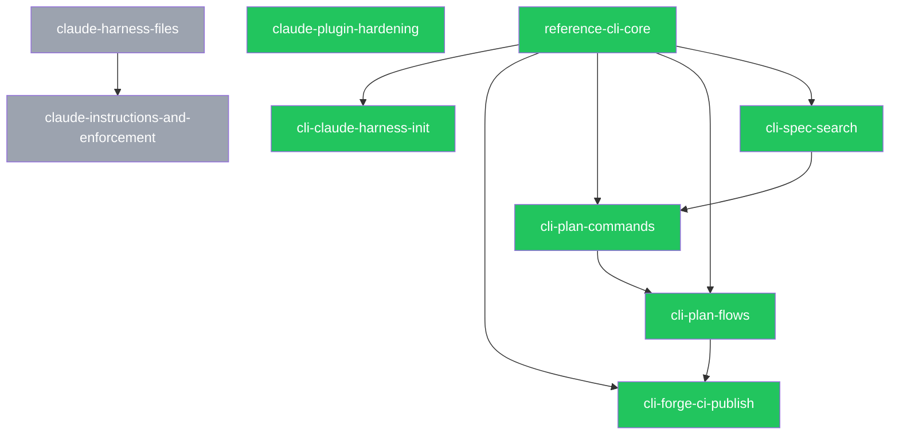

<!-- GENERATED FILE — do not edit by hand. Regenerate with: specplane generate -->

# Plans

## Active plans

| ID | Title | Status | Dependencies | Specs |
|----|-------|--------|--------------|-------|
| [2026-10-28-reference-cli-core](2026-10-28-reference-cli-core/PLAN.md) | Reference CLI core — validate and generate commands | ready | — | feature/tooling, feature/configuration, feature/spec-system, feature/plan-system, feature/plan-steps, feature/plan-index, feature/spec-overlays, architecture/reference-cli, architecture/file-formats, architecture/repository-layout, architecture/agent-skills |
| [2026-10-29-claude-plugin-hardening](2026-10-29-claude-plugin-hardening/PLAN.md) | Claude plugin hardening — hook guards and HANDOFF button | ready | — | claude:architecture/claude-integration, claude:feature/claude-integration |
| [2026-10-29-cli-claude-harness-init](2026-10-29-cli-claude-harness-init/PLAN.md) | CLI init --harness claude, harness registry, and skill findings | ready | [2026-10-28-reference-cli-core](2026-10-28-reference-cli-core/PLAN.md) | claude:feature/claude-integration, claude:architecture/claude-integration, feature/agent-integration, feature/tooling, architecture/agent-skills, architecture/reference-cli |
| [2026-10-29-cli-forge-ci-publish](2026-10-29-cli-forge-ci-publish/PLAN.md) | Forge integration, CI workflows, and npm publish setup | ready | [2026-10-28-reference-cli-core](2026-10-28-reference-cli-core/PLAN.md), [2026-10-29-cli-plan-flows](2026-10-29-cli-plan-flows/PLAN.md) | architecture/reference-cli, architecture/ci, feature/plan-execution, feature/plan-status, feature/configuration, feature/plan-index, feature/tooling |
| [2026-10-29-cli-plan-commands](2026-10-29-cli-plan-commands/PLAN.md) | CLI plan commands, effective status, and live activity | ready | [2026-10-28-reference-cli-core](2026-10-28-reference-cli-core/PLAN.md), [2026-10-29-cli-spec-search](2026-10-29-cli-spec-search/PLAN.md) | feature/tooling, feature/plan-status, feature/plan-index, feature/plan-system, feature/plan-steps, architecture/reference-cli, architecture/file-formats |
| [2026-10-29-cli-plan-flows](2026-10-29-cli-plan-flows/PLAN.md) | CLI plan flows — start, finish, abandon, cleanup, archive, restack | ready | [2026-10-28-reference-cli-core](2026-10-28-reference-cli-core/PLAN.md), [2026-10-29-cli-plan-commands](2026-10-29-cli-plan-commands/PLAN.md) | feature/plan-execution, feature/plan-status, feature/plan-steps, feature/tooling, feature/configuration, architecture/reference-cli, architecture/file-formats |
| [2026-10-29-cli-spec-search](2026-10-29-cli-spec-search/PLAN.md) | CLI spec and search commands, validation hardening | ready | [2026-10-28-reference-cli-core](2026-10-28-reference-cli-core/PLAN.md) | feature/tooling, feature/spec-system, feature/spec-overlays, feature/spec-precedence, feature/decisions, feature/configuration, architecture/reference-cli, architecture/file-formats |

## Archived plans

| ID | Title | Status | Specs |
|----|-------|--------|-------|
| [2026-10-29-claude-harness-files](archive/2026-10-29-claude-harness-files/PLAN.md) | Claude Code harness files — skills, hooks, CLAUDE.md | done | claude:feature/claude-integration, claude:architecture/claude-integration, feature/agent-integration, architecture/agent-skills |
| [2026-10-29-claude-instructions-and-enforcement](archive/2026-10-29-claude-instructions-and-enforcement/PLAN.md) | Claude harness — standing instructions, enforcement hooks, live view | done | claude:feature/claude-integration, claude:architecture/claude-integration, feature/agent-integration, architecture/agent-skills, architecture/file-formats |

## Dependency graph

