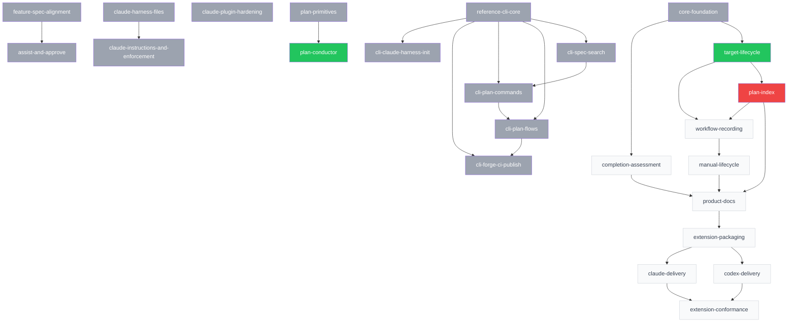

<!-- GENERATED FILE — do not edit by hand. Regenerate with: specplane plan index -->

# Plans

## Active plans

| ID | Title | Status | Target | Dependencies | Specs |
|----|-------|--------|--------|--------------|-------|
| [2026-10-30-plan-conductor](2026-10-30-plan-conductor/PLAN.md) | Plan conductor — plan run, session mode, and alerts | ready | repository default | [2026-10-30-plan-primitives](archive/2026-10-30-plan-primitives/PLAN.md) | architecture/reference-cli, architecture/agent-skills, feature/plan-execution, feature/configuration, feature/spec-precedence, feature/agent-integration, claude:architecture/claude-integration, claude:feature/claude-integration |
| [2026-11-01-claude-delivery](2026-11-01-claude-delivery/PLAN.md) | Claude extension-owned workflow delivery | draft | repository default | [2026-11-01-extension-packaging](2026-11-01-extension-packaging/PLAN.md) | architecture/reference-cli, architecture/agent-skills, claude:architecture/claude-integration, claude:feature/claude-integration |
| [2026-11-01-codex-delivery](2026-11-01-codex-delivery/PLAN.md) | Codex existing-session delivery | draft | repository default | [2026-11-01-extension-packaging](2026-11-01-extension-packaging/PLAN.md) | architecture/reference-cli, architecture/agent-skills, codex:architecture/codex-integration, codex:feature/codex-integration |
| [2026-11-01-extension-conformance](2026-11-01-extension-conformance/PLAN.md) | Cross-package conformance and rollout evidence | draft | repository default | [2026-11-01-claude-delivery](2026-11-01-claude-delivery/PLAN.md), [2026-11-01-codex-delivery](2026-11-01-codex-delivery/PLAN.md) | architecture/reference-cli, architecture/agent-skills, architecture/file-formats, codex:architecture/codex-integration, claude:architecture/claude-integration |
| [2026-11-01-extension-packaging](2026-11-01-extension-packaging/PLAN.md) | Compatible packages and recoverable installation | draft | repository default | [2026-11-02-product-docs](2026-11-02-product-docs/PLAN.md) | architecture/reference-cli, architecture/agent-skills, feature/agent-integration |
| [2026-11-01-manual-lifecycle](2026-11-01-manual-lifecycle/PLAN.md) | Human gates and neutral CLI lifecycle | draft | repository default | [2026-11-01-workflow-recording](2026-11-01-workflow-recording/PLAN.md) | architecture/reference-cli, architecture/agent-skills, feature/spec-policies, feature/plan-execution, feature/configuration, feature/decisions, feature/agent-integration |
| [2026-11-01-workflow-recording](2026-11-01-workflow-recording/PLAN.md) | Prepared workflows and exact recording | draft | repository default | [2026-11-02-plan-index](2026-11-02-plan-index/PLAN.md), [2026-11-02-target-lifecycle](2026-11-02-target-lifecycle/PLAN.md) | architecture/reference-cli, architecture/agent-skills, architecture/file-formats, feature/plan-steps, feature/spec-policies |
| [2026-11-02-completion-assessment](2026-11-02-completion-assessment/PLAN.md) | Implementation declarations and content assessment | draft | repository default | [2026-11-01-core-foundation](archive/2026-11-01-core-foundation/PLAN.md) | architecture/reference-cli, architecture/file-formats, feature/spec-system, feature/tooling, feature/spec-policies |
| [2026-11-02-plan-index](2026-11-02-plan-index/PLAN.md) | Explicit plan-index snapshots and lifecycle generation | blocked | repository default | [2026-11-02-target-lifecycle](2026-11-02-target-lifecycle/PLAN.md) | architecture/reference-cli, architecture/file-formats, architecture/ci, feature/plan-index, feature/tooling |
| [2026-11-02-product-docs](2026-11-02-product-docs/PLAN.md) | Offline product documentation and release orientation | draft | repository default | [2026-11-01-manual-lifecycle](2026-11-01-manual-lifecycle/PLAN.md), [2026-11-02-completion-assessment](2026-11-02-completion-assessment/PLAN.md), [2026-11-02-plan-index](2026-11-02-plan-index/PLAN.md) | architecture/reference-cli, architecture/file-formats, architecture/agent-skills, feature/agent-integration, feature/tooling |
| [2026-11-02-target-lifecycle](2026-11-02-target-lifecycle/PLAN.md) | Target binding and lifecycle reconciliation | ready | repository default | [2026-11-01-core-foundation](archive/2026-11-01-core-foundation/PLAN.md) | architecture/reference-cli, architecture/file-formats, feature/plan-execution, feature/configuration, feature/tooling, feature/plan-system |

## Archived plans

| ID | Title | Status | Target | Specs |
|----|-------|--------|--------|-------|
| [2026-10-28-reference-cli-core](archive/2026-10-28-reference-cli-core/PLAN.md) | Reference CLI core — validate and generate commands | done | repository default | feature/tooling, feature/configuration, feature/spec-system, feature/plan-system, feature/plan-steps, feature/plan-index, feature/spec-overlays, architecture/reference-cli, architecture/file-formats, architecture/repository-layout, architecture/agent-skills |
| [2026-10-29-assist-and-approve](archive/2026-10-29-assist-and-approve/PLAN.md) | Refine-then-write assist, the review role, and approval commands | done | repository default | feature/spec-policies, feature/configuration, feature/agent-integration, feature/tooling, architecture/agent-skills, architecture/reference-cli, architecture/file-formats, claude:feature/claude-integration, claude:architecture/claude-integration |
| [2026-10-29-claude-harness-files](archive/2026-10-29-claude-harness-files/PLAN.md) | Claude Code harness files — skills, hooks, CLAUDE.md | done | repository default | claude:feature/claude-integration, claude:architecture/claude-integration, feature/agent-integration, architecture/agent-skills |
| [2026-10-29-claude-instructions-and-enforcement](archive/2026-10-29-claude-instructions-and-enforcement/PLAN.md) | Claude harness — standing instructions, enforcement hooks, live view | done | repository default | claude:feature/claude-integration, claude:architecture/claude-integration, feature/agent-integration, architecture/agent-skills, architecture/file-formats |
| [2026-10-29-claude-plugin-hardening](archive/2026-10-29-claude-plugin-hardening/PLAN.md) | Claude plugin hardening — hook guards and HANDOFF button | done | repository default | claude:architecture/claude-integration, claude:feature/claude-integration |
| [2026-10-29-cli-claude-harness-init](archive/2026-10-29-cli-claude-harness-init/PLAN.md) | CLI init --harness claude, harness registry, and skill findings | done | repository default | claude:feature/claude-integration, claude:architecture/claude-integration, feature/agent-integration, feature/tooling, architecture/agent-skills, architecture/reference-cli |
| [2026-10-29-cli-forge-ci-publish](archive/2026-10-29-cli-forge-ci-publish/PLAN.md) | Forge integration, CI workflows, and npm publish setup | done | repository default | architecture/reference-cli, architecture/ci, feature/plan-execution, feature/plan-status, feature/configuration, feature/plan-index, feature/tooling |
| [2026-10-29-cli-plan-commands](archive/2026-10-29-cli-plan-commands/PLAN.md) | CLI plan commands, effective status, and live activity | done | repository default | feature/tooling, feature/plan-status, feature/plan-index, feature/plan-system, feature/plan-steps, architecture/reference-cli, architecture/file-formats |
| [2026-10-29-cli-plan-flows](archive/2026-10-29-cli-plan-flows/PLAN.md) | CLI plan flows — start, finish, abandon, cleanup, archive, restack | done | repository default | feature/plan-execution, feature/plan-status, feature/plan-steps, feature/tooling, feature/configuration, architecture/reference-cli, architecture/file-formats |
| [2026-10-29-cli-spec-search](archive/2026-10-29-cli-spec-search/PLAN.md) | CLI spec and search commands, validation hardening | done | repository default | feature/tooling, feature/spec-system, feature/spec-overlays, feature/spec-precedence, feature/decisions, feature/configuration, architecture/reference-cli, architecture/file-formats |
| [2026-10-29-feature-spec-alignment](archive/2026-10-29-feature-spec-alignment/PLAN.md) | Align architecture specs and CLI with applied feature specs | done | repository default | feature/configuration, feature/decisions, feature/plan-index, feature/plan-status, feature/plan-steps, feature/plan-system, feature/spec-precedence, feature/tooling, architecture/reference-cli, architecture/file-formats, architecture/agent-skills, claude:feature/claude-integration, claude:architecture/claude-integration |
| [2026-10-30-plan-primitives](archive/2026-10-30-plan-primitives/PLAN.md) | Plan primitives — next, step-done, and harness doc fixes | done | repository default | architecture/reference-cli, architecture/agent-skills, feature/plan-status, feature/agent-integration, claude:architecture/claude-integration, claude:feature/claude-integration |
| [2026-11-01-core-foundation](archive/2026-11-01-core-foundation/PLAN.md) | Core contracts, coordination and provenance | done | repository default | architecture/reference-cli, architecture/file-formats, feature/tooling, feature/agent-integration |

## Dependency graph

