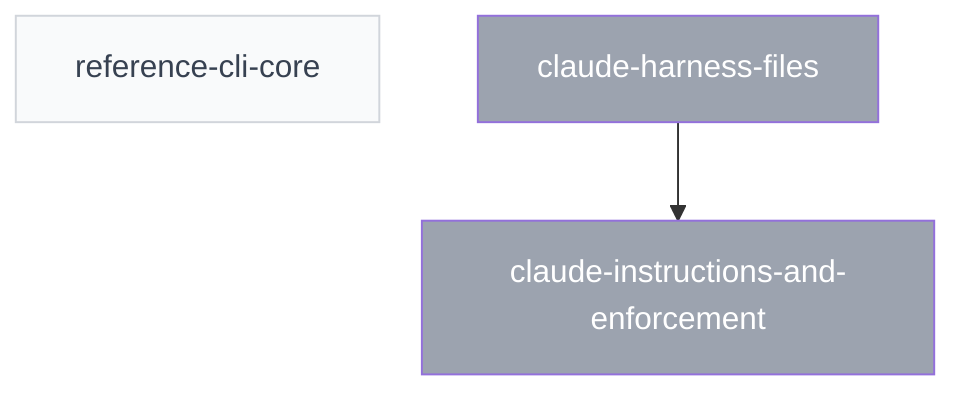

<!-- GENERATED FILE — do not edit by hand. Regenerate with: specplane generate -->

# Plans

## Active plans

| ID | Title | Status | Dependencies | Specs |
|----|-------|--------|--------------|-------|
| [2026-10-28-reference-cli-core](2026-10-28-reference-cli-core/PLAN.md) | Reference CLI core — validate and generate commands | draft | — | feature/tooling, feature/configuration, feature/spec-system, feature/plan-system, feature/plan-steps, feature/plan-index, feature/spec-overlays, architecture/reference-cli, architecture/file-formats, architecture/repository-layout, architecture/agent-skills |

## Archived plans

| ID | Title | Status | Specs |
|----|-------|--------|-------|
| [2026-10-29-claude-harness-files](archive/2026-10-29-claude-harness-files/PLAN.md) | Claude Code harness files — skills, hooks, CLAUDE.md | done | claude:feature/claude-integration, claude:architecture/claude-integration, feature/agent-integration, architecture/agent-skills |
| [2026-10-29-claude-instructions-and-enforcement](archive/2026-10-29-claude-instructions-and-enforcement/PLAN.md) | Claude harness — standing instructions, enforcement hooks, live view | done | claude:feature/claude-integration, claude:architecture/claude-integration, feature/agent-integration, architecture/agent-skills, architecture/file-formats |

## Dependency graph

